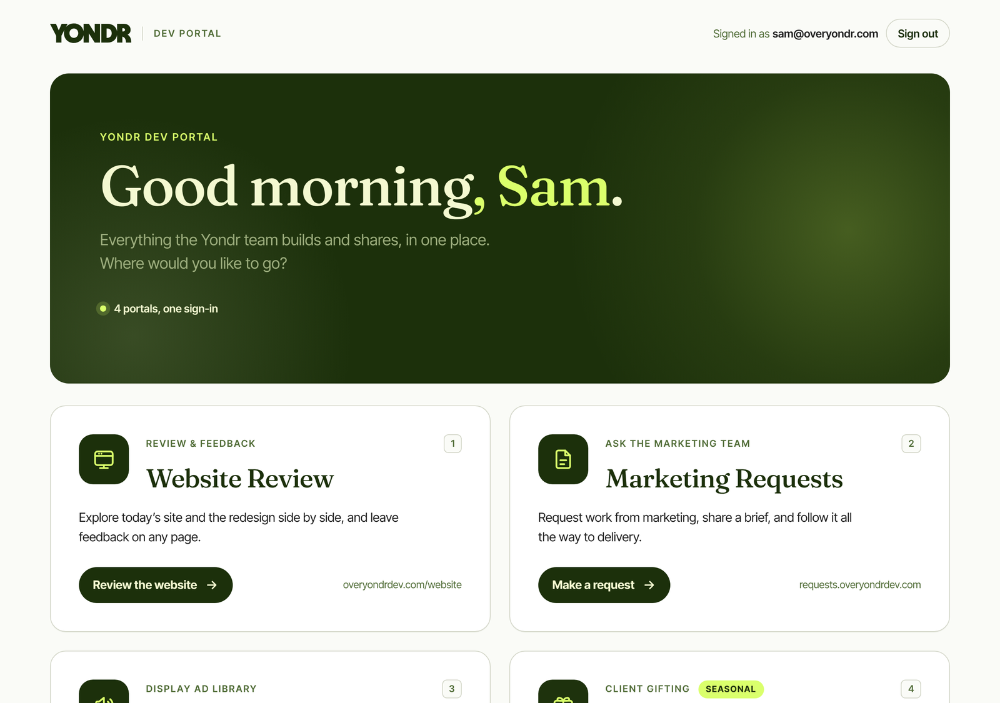

# 01 · Start here

**overyondrdev.com is Yondr's private dev portal**: one place where the Yondr team reviews the website, asks marketing
for work, finds display ads, collects Christmas card recipients, and where admins run the whole estate. It started as a
place to evaluate the new website and has grown into a full internal portal.

## The five-minute version

1. **Who can get in:** anyone with an **@overyondr.com** Google account. Nobody else. There is one sign-in for every
   site (12 hours), at `auth.overyondrdev.com`. → [Sign-in](03-sign-in-and-access.md)
2. **What's there** (each is its own small Cloudflare Worker on its own address): → [Platform map](02-platform-map.md)
   - **overyondrdev.com**: the Dev Portal home. Pick a portal.
   - **Website Review** (`overyondrdev.com/website`): **V1** = today's overyondr.com rebuilt off Squarespace;
     **V2** = the redesign that will become overyondr.com. Leave feedback on any page.
   - **Marketing Requests** (`requests.`), **Ad Campaigns** (`ads.`), **Christmas Card Request** (`cards.`, seasonal).
   - For admins: the **Feedback dashboard** (`feedback.`) and **Yondr Ops** (`ops.`): monitoring, alerts, backups,
     issues, auto-fix, people and permissions.
3. **We never pay Cloudflare per person.** Sign-in is done by our own Workers; Cloudflare Access is set to **Bypass**
   everywhere, so it uses **0 seats**. Never change that. → [Why](03-sign-in-and-access.md#why-no-cloudflare-seats)
4. **Code** is in public GitHub repositories (org `Overyondrdev`). Never commit secrets, personal email addresses or
   client data. Changes go through a pull request; **merging deploys**. → [How we work](08-how-we-work.md)
5. **Claude agents do most of the building.** A "hub" session coordinates, a daily status report goes to the owner,
   and the owner replies to it with numbers to approve actions. → [How we work](08-how-we-work.md#claude-sessions)
6. **Ops watches everything** every 5 minutes and emails/Slacks admins when something breaks.
   → [Operations](06-operations.md)

## If you are…

| You are | Read next |
| --- | --- |
| A Yondr colleague who wants to use the tools | [The portals: a user guide](04-portals-guide.md) |
| An admin | [Operations](06-operations.md), [Auto-fix](07-auto-fix.md), [Runbooks](09-runbooks.md) |
| A developer or Claude agent about to change something | [How we work](08-how-we-work.md), [Platform map](02-platform-map.md), then the repository's `CLAUDE.md` |
| The owner | [Status and roadmap](11-status-and-roadmap.md), [Decisions log](10-decisions-log.md) |

## The non-negotiables

- **@overyondr.com Google sign-in on every request** to every overyondrdev.com site, static files included.
- **No Cloudflare Access seats.** Access stays **Bypass**; Ops raises a high alert if anyone changes that.
- **No secrets, personal email addresses or client data in GitHub.** The repositories are public (free plan).
- **overyondr.com itself is still on Squarespace** until the owner signs off the cutover. Nothing adds overyondr.com
  routes before that.
- **Ask the owner first** for: the overyondr.com cutover, DNS changes, moving domains, deleting data, turning auto-fix
  on, extra auto-fix spend, and sign-in or secret changes. Everything else: merge when ready.
- **Every person field uses the directory picker** (name/email autofill). → [People directory](05-people-directory.md)
- **Docs move with code**: change behaviour → update this handbook in the same pull request.

## Who's who (roles, not names)

| Role | What they do |
| --- | --- |
| **Owner** | Decides; approves the "ask first" list; holds the Google Cloud, Cloudflare and GitHub admin logins |
| **Admins** | Use the Feedback dashboard and Yondr Ops; one admin list, managed in Feedback → People & access |
| **IT contact** | Google Workspace settings (mail allow-lists, groups, app trust) |
| **Hub Claude session** | Coordinates the other sessions, keeps this handbook and the inventory true, runs checks |
| **Area Claude sessions** | One per area (website, ad library, marketing requests, Christmas cards…) |
| **Yondr staff** | Everyone with an @overyondr.com account: uses the portals, leaves feedback |
