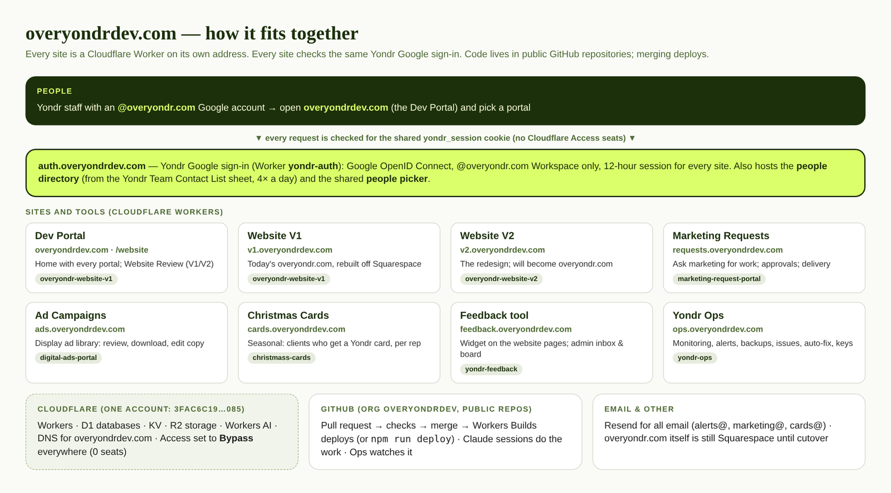

# 02 · Platform map

Everything runs on **Cloudflare** (one account, `3fac6c19097c5692e17198cffa818085`). Every site is a **Worker**
(a small program at Cloudflare's edge) on its own subdomain. Code is on **GitHub** (org `Overyondrdev`, all public).

## Sites, Workers and repositories

| Address | What it is | Worker | Repository | Deploys |
| --- | --- | --- | --- | --- |
| `overyondrdev.com`, `www.` | Dev Portal home; `/website` = Website Review | `overyondr-website-v1` | `overyondr-website-v1` | Workers Builds on merge |
| `v1.overyondrdev.com` | Website V1: overyondr.com rebuilt off Squarespace | `overyondr-website-v1` | `overyondr-website-v1` | Workers Builds on merge |
| `v2.overyondrdev.com` | Website V2: the redesign (future overyondr.com) | `overyondr-website-v2` | `overyondr-website-v2` | Workers Builds on merge |
| `auth.overyondrdev.com` | Yondr Google sign-in + people directory + picker | `yondr-auth` | `overyondr-website-v1` (`auth/`) | `npm run deploy` in `auth/` |
| `requests.overyondrdev.com` | Marketing Requests | `yondr-marketing-requests` | `marketing-request-portal` | `npm run deploy` (migrations first) |
| `ads.overyondrdev.com` | Ad Campaigns (display ad library) | `yondr-ad-portal` | `digital-ads-portal` | Workers Builds on merge |
| `cards.overyondrdev.com` | Christmas Card Request (seasonal) | `yondr-christmas-cards` | `christmass-cards` | Workers Builds on merge |
| `feedback.overyondrdev.com` | Feedback tool: widget, API, admin dashboard | `yondr-feedback` | `yondr-feedback` | `npm run deploy` |
| `ops.overyondrdev.com` | Yondr Ops: monitoring, alerts, backups, issues, auto-fix | `yondr-ops` | `yondr-ops` | `npm run deploy` |

**V1 and V2 are completely separate** (owner decision): different designers, different repositories, different
Workers. Don't put V2 code in V1 or the other way round.

## Data: where it lives

| Store | Belongs to | Holds | Personal data? |
| --- | --- | --- | --- |
| D1 `yondr-feedback`, KV `yondr-feedback-screenshots` | Feedback | Feedback items, comments, admins list, screenshots | Staff names/emails |
| D1 `yondr-ops`, R2 `yondr-ops-backups` | Ops | Checks, incidents, alerts, issues, audit log, auto-fix log, keys calendar; nightly backups | Staff emails |
| D1 `yondr-ops-restore-drill` | Ops | Scratch copy for the monthly restore test, emptied afterwards | Briefly |
| D1 `yondr-marketing-requests-db`, R2 `yondr-marketing-requests-files` | Marketing Requests | Requests, briefs, approvals, files | Staff |
| D1 `yondr-ad-portal-db`, R2 `yondr-ad-portal-assets` | Ad Campaigns | Ads, campaigns, roles, reviews | Staff |
| D1 `yondr-christmas-cards` | Christmas cards | **Client names and addresses** (kept; per-rep lists) | **Yes: client data** |
| KV `yondr-directory` | Sign-in (`yondr-auth`) | People directory: name, email, title only | Staff |
| R2 `yondr-brand-public` | Brand | Public brand files | No |

**Never delete live data** without the owner's say-so. Databases change only additively (new tables/columns).
Backups: [Operations → Backups](06-operations.md#backups-and-the-restore-drill).

## The DNS zone (overyondrdev.com)

Each site address is a Worker **custom domain** (Cloudflare manages it). The rest of the zone is **email**: Resend
(`resend._domainkey` DKIM, `send` and `rsend` CNAMEs), Cloudflare Email (`cf-bounce*`) and `_dmarc` (`p=reject`).
**DNS changes need the owner's approval.**

## overyondr.com (the public site)

Still on **Squarespace**. At the **cutover**, the signed-off website (V2 is on its way to being that) will serve
overyondr.com. Until the owner signs off, nothing adds overyondr.com routes. The V1 Worker already knows how to serve
any non-dev host, and analytics tags are re-added only at cutover.

## Scheduled jobs

| Job | Where | When |
| --- | --- | --- |
| Site checks (sign-in gate, health, Cloudflare usage) | Ops | every 5 minutes |
| Auto-fix watch (PRs, deploys, verification, automatic revert) | Ops | every 5 minutes |
| Backups, restore drill (monthly), key reminders, access review, retention | Ops | 03:17 UTC daily |
| People directory sync from the Team Contact List | `yondr-auth` | 01:23, 07:23, 13:23, 19:23 UTC |
| Daily status report to the owner | Claude scheduled task | 07:47 New York, daily |
| Weekly hygiene report (branches, dependencies, docs drift) | Claude scheduled task | Mondays 10:23 New York |

Deeper detail: `docs/OPERATIONS.md` §1 (inventory) and `docs/PLATFORM.md` §1.
