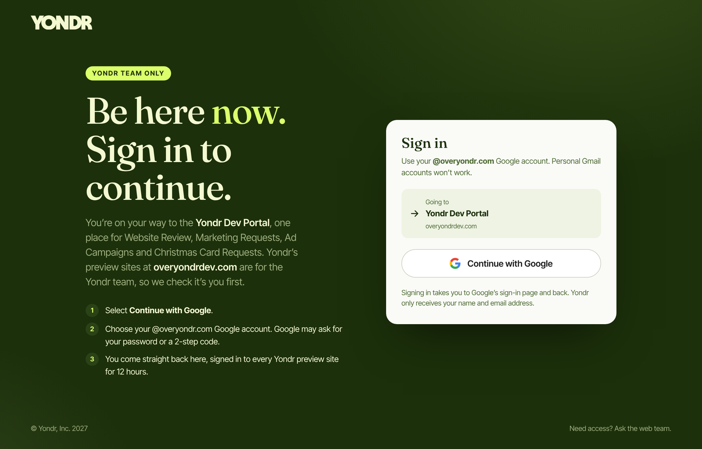
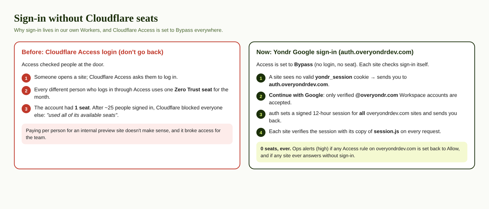

# 03 · Sign-in and access (no Cloudflare seats)

**Every overyondrdev.com site is private to Yondr staff.** People sign in once with their **@overyondr.com Google
account** at `auth.overyondrdev.com` and stay signed in to every site for **12 hours**.

## How it works

1. You open any overyondrdev.com page. The site looks for the `yondr_session` cookie. None, or expired? It sends you to
   `auth.overyondrdev.com/login`, which says where you're going.
2. **Continue with Google.** The sign-in Worker (`yondr-auth`) accepts only **verified Google Workspace accounts of
   overyondr.com** (both the Workspace and the email domain are checked). Personal Gmail is refused with a clear message.
3. It sets a signed (ES256) session cookie for `.overyondrdev.com`, 12 hours, and sends you back.
4. **Every site checks that cookie itself on every request**, static files included, with its own unchanged copy of
   `auth/src/session.js`. Pages redirect to sign-in; APIs answer 401.
5. Sign out anywhere: `auth.overyondrdev.com/logout` signs you out of every site.

The Google client is an **Internal** OAuth app in the Google Cloud project used for the sign-in. Its ID/secret and the
session signing key are secrets on `yondr-auth`. Key rotation: `auth/README.md`.

## Why no Cloudflare seats

- **Cloudflare Access charges one Zero Trust seat per distinct person who logs in through it**, per month, whatever
  the login method. The account has **1 seat**. When about 25 colleagues signed in through Access, Cloudflare blocked
  everyone else ("used all of its available seats").
- **Bypass** rules don't log anyone in, so they cost nothing. So sign-in moved into our own Workers, and **every
  Cloudflare Access rule on overyondrdev.com is Bypass**, including the catch-all `*.overyondrdev.com` (owner decision,
  27 Nov 2026: *never use Cloudflare seats anywhere*).
- **Target:** Cloudflare Zero Trust → Overview shows **0 of 1 seats**.
- **Guard rails:**
  - Ops checks hourly that every site is listed in a Bypass rule **and that no Access rule on overyondrdev.com has a
    non-Bypass policy** (high alert if one appears).
  - Ops checks every 5 minutes that every site still demands sign-in (`site_exposed` alert if one answers signed out).
- **Never** set an overyondrdev.com Access policy back to "Allow". If you think you need to, ask the owner.

### What Bypass means for new sites

Because Access no longer blocks unknown hosts, **a new site's own session check is the only lock**. Follow the
checklist in [Runbooks → Add a new site](09-runbooks.md#add-a-new-site-or-portal) exactly: session check on every
request before the address goes live, and add the address to Ops' sign-in checks.

## Who can do what (roles)

Sign-in only proves you're Yondr staff. Each tool has its own roles:

| Tool | Roles | Managed in |
| --- | --- | --- |
| Feedback + Ops (one shared admin list) | Owner, Admin; everyone can leave feedback; staff see Ops' Status page | Feedback → **People & access** (Ops → People & permissions changes it through Feedback) |
| Marketing Requests | Requester, Approver, Marketing team, Admin/Owner | Marketing Requests → **People & routing** (and the roles sheet in Drive) |
| Ad Campaigns | Viewer, Editor, Admin, Owner | Ad Campaigns → **People** |
| Christmas cards | Staff (own list), Admin | Christmas cards → **/admin → Admins** |

Owner lists are secrets or database rows, never committed files.

## Troubleshooting

| Symptom | Cause and fix |
| --- | --- |
| "Use your Yondr account" for a real colleague | They chose a personal Google account → *Use another account*. If it persists, their Workspace domain differs (see `docs/PLATFORM.md` §2) |
| "App blocked by administrator" | A Workspace admin marks the Yondr app as Trusted (admin.google.com → Security → API controls → App access control) |
| Signed out sooner than expected | Sessions last 12 hours; signing out on one site signs out everywhere |
| Cloudflare asks for a code or shows "seats used" | An Access rule isn't Bypass. Ops should already have alerted. Owner: Zero Trust → Access → Applications → set the policy to Bypass |

Deeper detail: `docs/PLATFORM.md` §2–3, `auth/README.md`, `auth/CUTOVER.md`.
