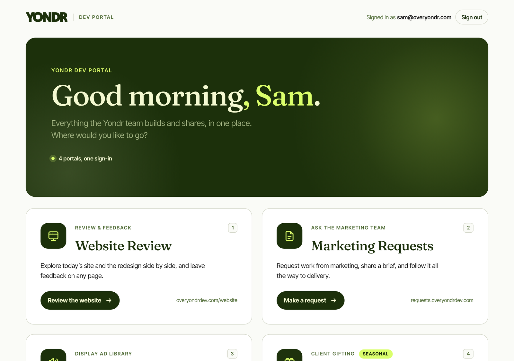
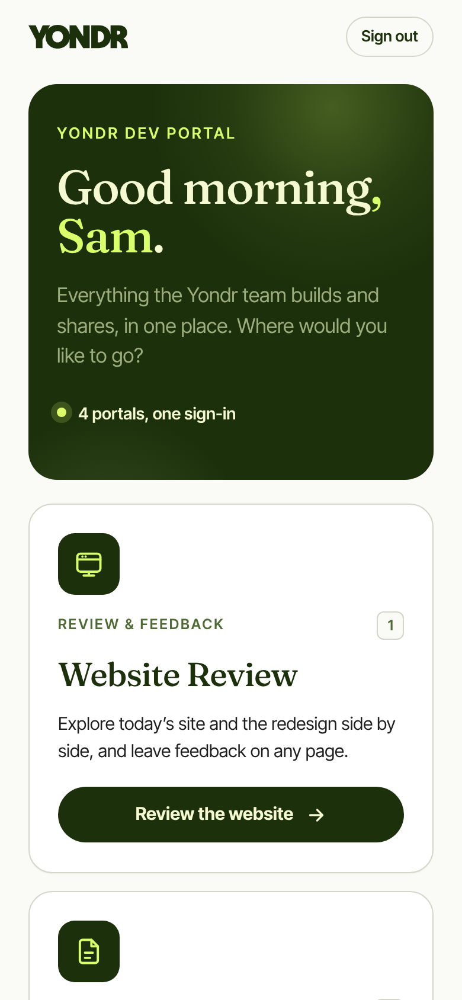
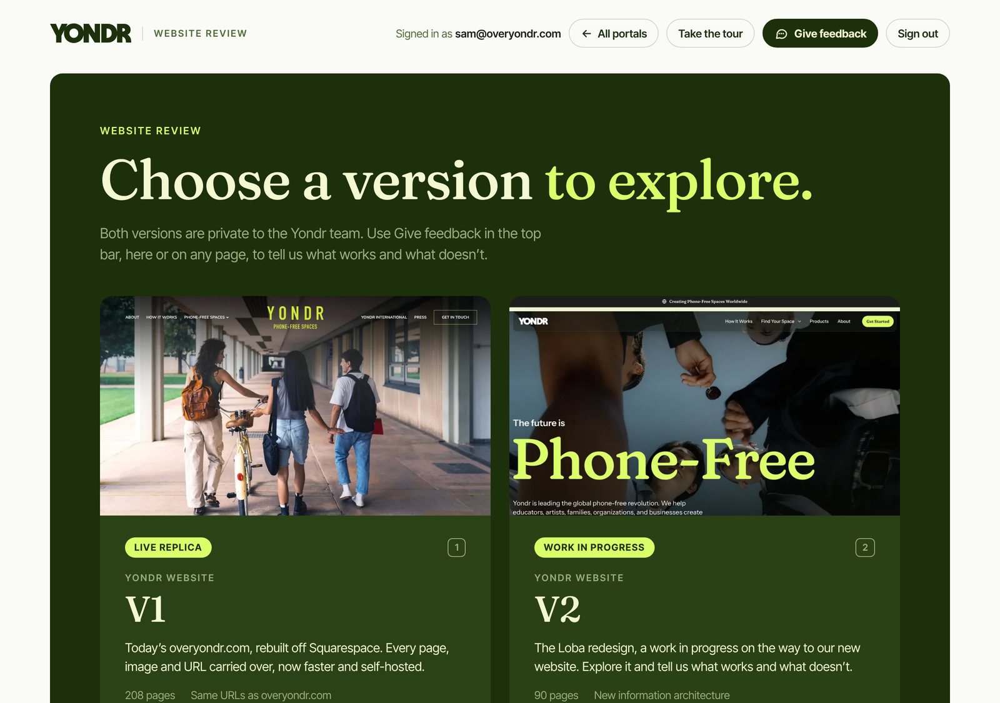
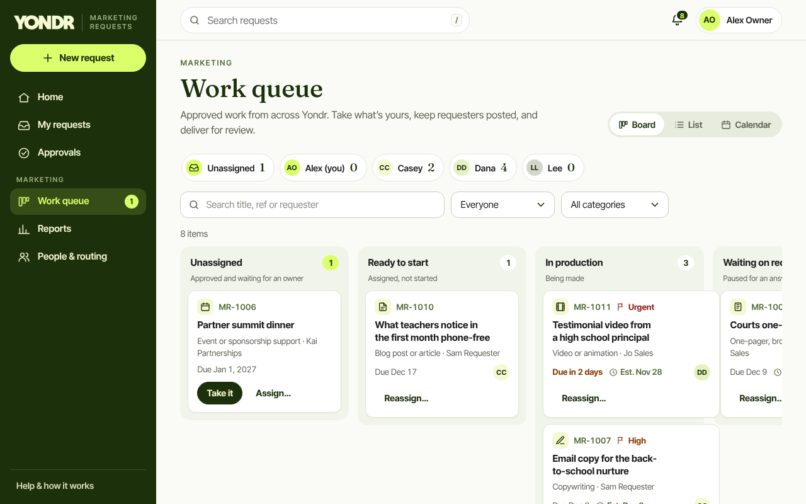
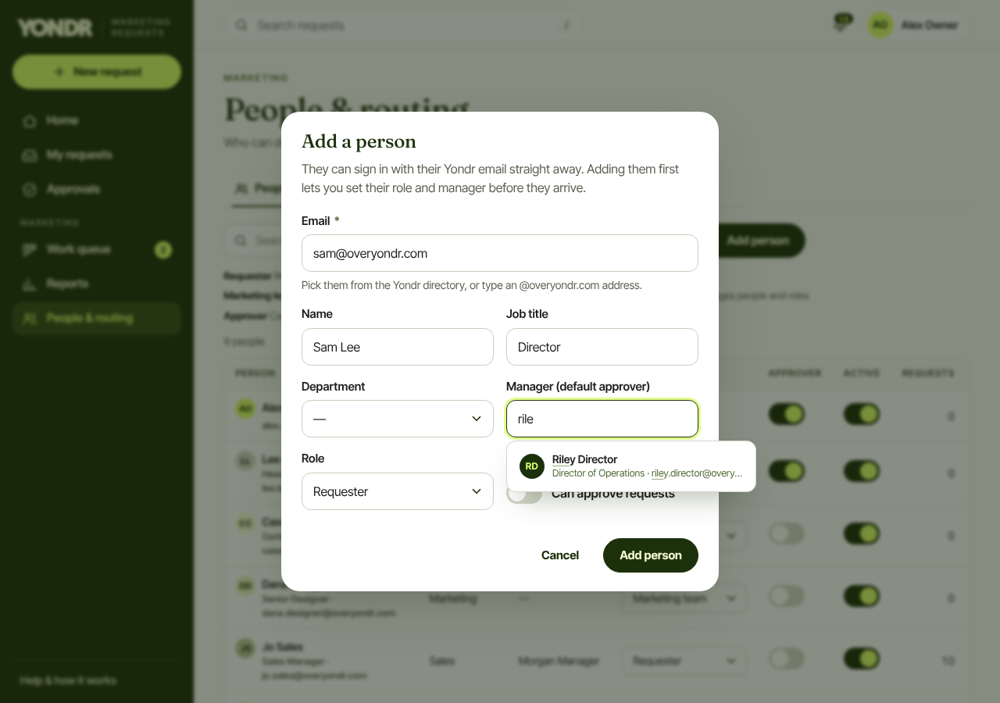
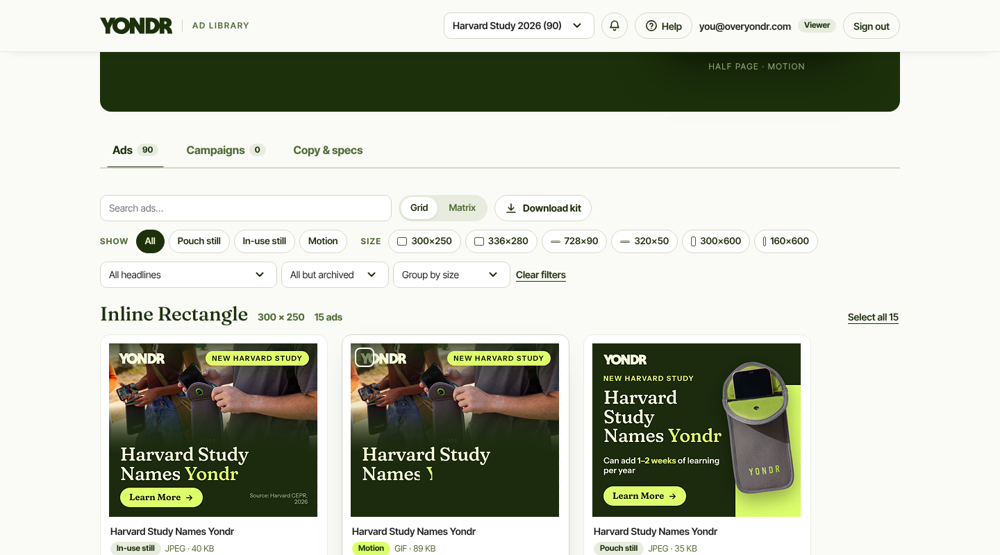
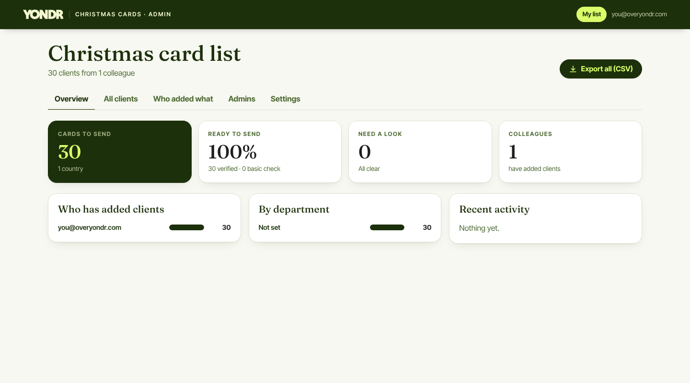
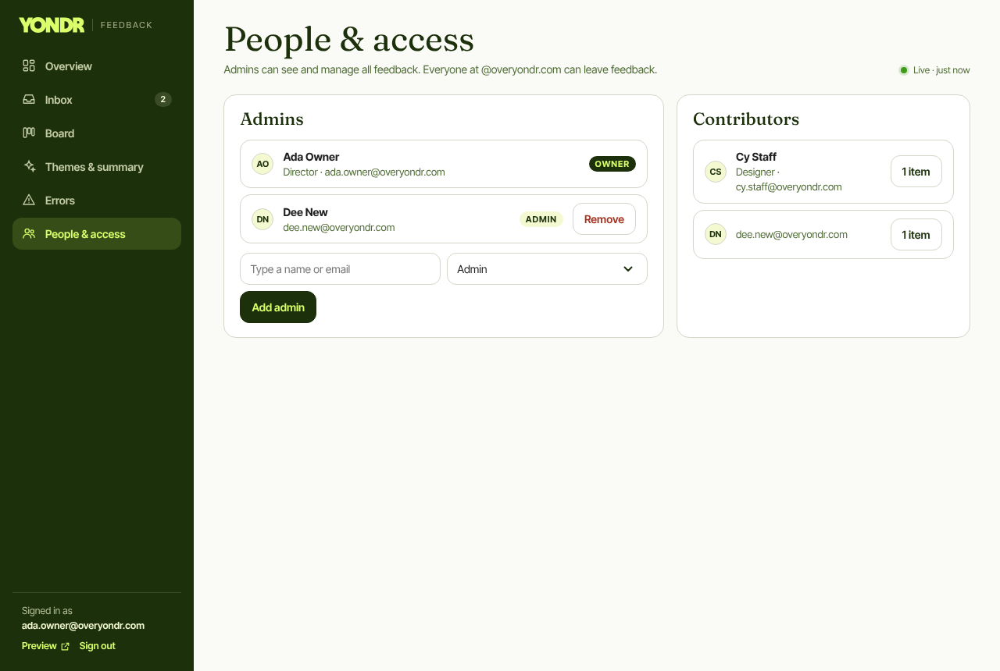
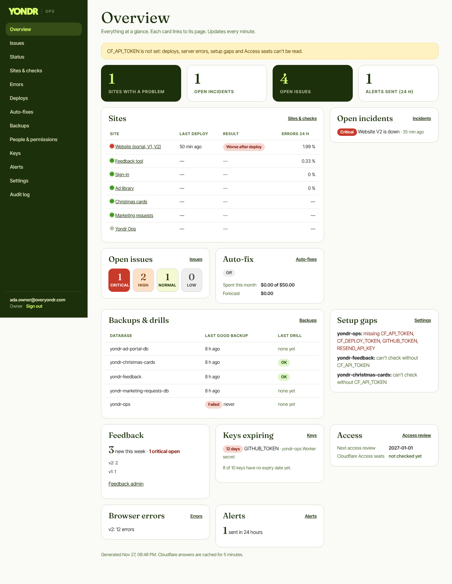

# 04 · The portals: a user guide

Go to **overyondrdev.com**, sign in with your @overyondr.com Google account, and pick a portal. Every portal has the
same habits:
- **The Yondr logo** (top left) always takes you back to the Dev Portal home. The portal's own name next to it takes
  you to that portal's start page.
- **The header stays at the top** while you scroll.
- **Name and email fields autofill** from the Yondr directory: type a letter or two and pick from the short list
  ([People directory](05-people-directory.md)).
- Everything works on a phone (375 px wide and up) and with the keyboard.

_Screenshots below use example data._

## The Dev Portal home (overyondrdev.com)

- A greeting with your first name, then the portals: **Website Review**, **Marketing Requests**, **Ad Campaigns**,
  **Christmas Card Request** (marked *Seasonal*).
- Keys **1–4** jump straight in; your **last visited** portal is marked.
- Admins also see **Feedback dashboard** and **Yondr Ops** links.
- On phones the portals stack and the header stays one row.

Adding a portal: [Runbooks](09-runbooks.md#add-a-new-site-or-portal).

## Website Review (overyondrdev.com/website)

- **V1**: today's overyondr.com, rebuilt off Squarespace (same pages and URLs, faster, self-hosted).
- **V2**: the redesign, work in progress, on its way to becoming overyondr.com.
- **Give feedback** (top bar, and on every V1/V2 page): click it, then **Screenshot** or **Point at it** to mark a
  spot, choose bug/idea/question, and send. **Take the tour** shows how in a few steps. Bug reports may be shared
  publicly for auto-fix, so don't include personal or confidential details ([Auto-fix](07-auto-fix.md)).

## Marketing Requests (requests.overyondrdev.com)

- **Ask marketing for work**: *New request* → choose the type (one-pager, video, event…) → fill the brief.
- **Approvals**: your manager is the default approver. Pick someone else from the directory if needed.
- **Follow** a request (or add followers) to get updates. Marketing works from the **Work queue** board, list or
  calendar.
- Admins manage people and routing in **People & routing**. Picking a person from the directory fills in their name
  and title.

Roles and permissions are listed in the Drive sheet *Marketing request portal: roles and permissions*. Help: the
**Help & how it works** link in the app.

## Ad Campaigns (ads.overyondrdev.com)

- Browse every display ad by size and type; **Download kit** for a set; open an ad to review it.
- **Editors** change copy; the ad re-renders in the browser and must stay under 150 KB.
- **Campaigns** group ads with an owner (picked from the directory). **People** (admins): give someone access with a
  role.
- Ad claims are attributed to the Harvard CEPR study; never invent statistics.

## Christmas Card Request (cards.overyondrdev.com), seasonal

- Staff add the clients who should get a Yondr Christmas card (name, address, optional email), with an address check.
- The card team works in **/admin**: overview, all clients (filter by who added them), who added what, admins,
  settings, and CSV export.
- Client addresses are **personal data**: they are kept (owner decision) and associated with each rep for per-rep
  lists. Never copy them out of the app except through its export.

## Feedback dashboard (feedback.overyondrdev.com/admin), admins

- **Inbox** and **Board** of everything people sent from the website pages, with screenshots and the exact page spot.
- **Themes & summary** groups similar feedback. **Errors** shows browser errors the pages reported.
- Assign an **Owner** (anyone in the directory), set status and priority, and mark bugs objective or subjective
  ([Auto-fix](07-auto-fix.md)).
- **People & access**: the one admin list for Feedback **and** Ops (owners and admins).

## Yondr Ops (ops.overyondrdev.com), admins

The control room: site health, incidents, issues, deploys and rollback, errors, backups, auto-fixes, keys, alerts,
people and permissions, audit log. Staff who aren't admins see the read-only **Status** page. Full guide:
[Operations](06-operations.md).
