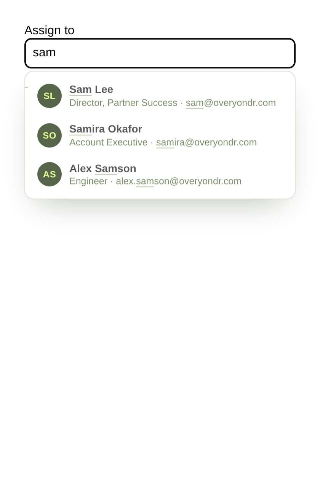

# 05 · People directory and autofill

**Rule (owner, 27 Nov 2026): every field where someone enters a Yondr person, now and in future, autofills from the
company directory.** That covers assignees, approvers, watchers, owners, reviewers, reps, admins, users and alert
recipients. Typing shows only the few relevant people, never a long dropdown.

## What people see

- Type one or two letters of a first name, last name or email: **up to 6 matches**, each with initials, **name and
  job title**. No city or phone.
- ↓/↑ and Enter (or click/tap) to pick; Esc closes. The field fills with the person's email (or name, where the field
  wants a name). Forms with a separate Name field fill it too.
- An empty field shows **your 5 most recent picks**.
- Accents don't matter ("jose" finds "José"). It works inside pop-up dialogs, on phones and with screen readers
  (ARIA combobox).
- Fields that may hold outside addresses (e.g. an alert recipient added by an owner) still accept any typed email.

## Where the data comes from

The **Yondr Team Contact List** Google Sheet (in the owner's Drive) is the source. It's updated by people as the team
changes. The platform copies it automatically:

| Step | What happens |
| --- | --- |
| 1. Read | **4 times a day.** **Today** (owner decision, 28 Nov 2026): a scheduled Claude task reads only the name, email and title columns through the **owner's Google Sheets connection** and loads them with the same rules. **Later, optionally:** a read-only Google service account (`yondr-directory-reader`) lets the sign-in Worker read the sheet itself, without depending on the owner's connection. |
| 2. Keep only what's needed | First name, last name, @overyondr.com email, title. **Phone numbers and locations never leave the sheet.** |
| 3. Check | Rows without a valid @overyondr.com email are skipped and listed by row number. If an update would remove **more than 20 %** of people at once, it is **not applied** (a filter or sorting slip can't wipe the directory). |
| 4. Store | KV `yondr-directory`. People removed from the sheet become *inactive*: no longer suggested, but old records still show their name. |
| 5. Serve | `auth.overyondrdev.com/api/people` (signed-in staff only) and the shared picker script `auth.overyondrdev.com/people-picker.js`. |
| 6. Watch | Ops checks hourly: last good update, failures, held-back updates. Overview shows "People directory: N people, updated X ago". The daily digest lists who joined and who left. |

If a sync is missed, the next use of the picker after 7 hours triggers a catch-up in the background.

### Keeping the sheet healthy

- One row per person; **First**, **Last Name**, **E-Mail** (an @overyondr.com address) and **Title** columns. Column
  order doesn't matter; renaming those headers slightly is tolerated, removing them is not.
- Removing someone from the sheet removes them from suggestions at the next sync.
- Changes appear within about 6 hours. Need it sooner? Ask the hub session to run a sync.

## Adding the picker to a field (developers and agents)

1. Load the script once per page: ``.
2. Mark the field: `<input type="email" data-people>`. Options: `data-people-fill="name"`, `data-people-external`.
3. CSP: allow `https://auth.overyondrdev.com` in `script-src` and `connect-src`.
4. Listen for `people:select` (`detail = { name, email, title }`) to fill a Name field or add the person at once.
5. Keep server-side validation. Never add `<datalist>`s or custom staff dropdowns for people.

Not for: client/customer fields (e.g. Christmas card recipients) and someone's own profile name.
Full reference: `docs/PLATFORM.md` §8 and `auth/README.md` "People directory".

## Optional upgrade: a service account (owner)

Not needed today. Do it if the directory should keep updating without the owner's Google connection (for example if
the owner changes role). Once the key is added, the Worker takes over at its next scheduled run, and the Claude refresh
task is switched off.

1. Google Cloud (the sign-in project): enable **Google Sheets API**.
2. Create service account `yondr-directory-reader` (no roles) → Keys → JSON key.
3. Share the Team Contact List with the service account's email as **Viewer**.
4. Cloudflare → `yondr-auth` → Settings → Variables and Secrets → Secret `DIRECTORY_SA_KEY` = the JSON file's content.
   Delete the downloaded file.
5. Check: Ops Overview shows the people count. Then disable the scheduled task "overyondrdev.com people directory refresh".

The key is listed in the Ops **Keys** calendar. Rotating it: create a new JSON key, replace the secret, delete the old
key in Google Cloud.
