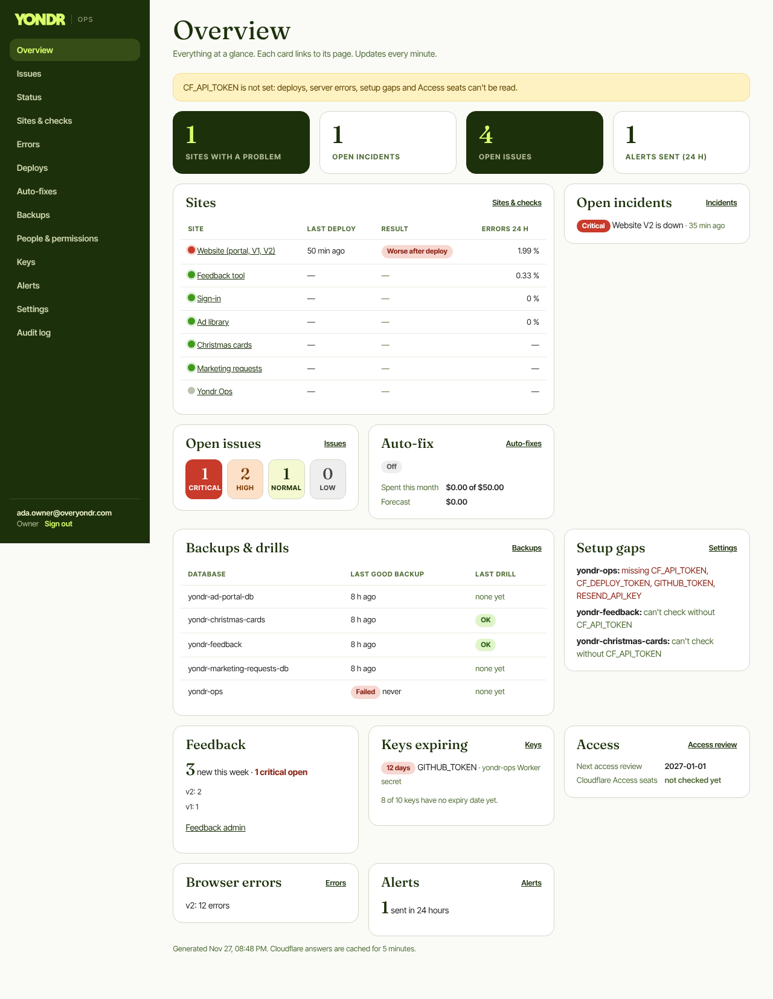

# 06 · Operations: monitoring, alerts, backups, email

**Yondr Ops** (`ops.overyondrdev.com`) is the control room. Admins see everything; other staff see the read-only
**Status** page. Full technical reference: the `yondr-ops` repository README.

## What is watched

| Check | How often | Alert |
| --- | --- | --- |
| Every site answers a signed-out visit with the sign-in page (never content) | 5 min | `site_exposed` (critical) / `site_down` |
| `auth` sign-in page, feedback widget, APIs answer as expected | 5 min | `site_down` |
| overyondr.com still Squarespace (until cutover) | 5 min | `config_drift` |
| Server errors per Worker (> 2 % warning, > 10 % high, ≥ 20 requests); browser error spikes; a deploy that makes things worse | 5 min | `error_rate`, `client_errors_spike`, `deploy_regression` |
| Latest deploy of `main` per Worker succeeded | 5 min | `deploy_failed` |
| Cloudflare Access: every site in a Bypass rule; **no seat-costing Access rule anywhere**; seats in use | hourly / daily | `config_drift` (seat rule = high), `access_seats_used` |
| Inventory: Workers, D1, KV, R2 match the expected list | hourly | config drift |
| Cloudflare usage (requests, D1 rows, Workers AI) vs plan | hourly | `usage_limit` |
| People directory synced in the last 13 hours | hourly | `config_drift` |
| Backups ran; monthly restore drill passed | daily | `backup_failed`, `restore_drill_failed` |
| Keys expiring in 30 / 14 / 0 days | daily | `key_expiring` |

Ops alerts **on change** (and again when resolved). Critical problems re-alert hourly until fixed.

## Alerts: who gets what

- Admins add people on **Alerts** and choose per person: alert types, **email** (Resend) and/or **Slack**, minimum
  severity and quiet hours.
- **Owners always get** `site_down`, `site_exposed`, rollback, restore-drill failures, expiring keys, critical issues
  and auto-fix budget alerts. Critical alerts ignore quiet hours.
- Owners may add an **outside address** (e.g. a personal Gmail for testing, while work mail filters are sorted out).
- Every alert is logged (**Alerts → log**). **Send test alert** checks delivery.

## Issues, incidents, deploys

- **Issues**: things to fix, created automatically (from failing checks and from feedback) or by hand. Assign them
  with the directory picker (assignees are emailed), set priority, and track them to closed.
- **Incidents** open when a site check fails and close when it recovers.
- **Deploys**: every Worker's recent deployments. A deploy that makes a site check fail is flagged. Owners can **roll
  back** to the previous version (confirmed, audited; uses a separate deploy token).
- **Errors**: server errors per Worker and browser errors reported by the pages.

## Backups and the restore drill

- **Nightly (03:17 UTC)**: every D1 database (feedback, ops, ad library, marketing requests, Christmas cards) is
  backed up to the private R2 bucket `yondr-ops-backups`. Kept: **30 daily + 12 monthly** (the Christmas card addresses, which are personal data, have a shorter retention setting). A weekly digest confirms backups are running.
- **Monthly restore drill**: the latest backup is restored into the scratch database `yondr-ops-restore-drill` and
  checked (tables and row counts). Personal data is wiped from the scratch copy straight after. A failure alerts owners.
- Downloads of backups with personal data (Christmas card addresses) are **owners only**.
- Restoring for real: [Runbooks → Restore a database](09-runbooks.md#restore-a-database-from-backup).

## Keys calendar and access review

- **Keys**: where every key/token lives, who owns it and when it expires. **Never the key itself.** Reminders at 30,
  14 and 0 days. Current entries include the GitHub token (expires 27 Nov 2027), the Cloudflare API tokens, the Resend
  keys, the Claude API key, the ingest token, the Google sign-in secret, the session signing key and the directory
  service account key.
- **Quarterly access review**: on the first weekday of January, April, July and October, Ops opens an issue listing who has admin or elevated roles in every tool and when they were last seen (90+ days unseen are flagged), for an owner to confirm.

## The daily report and the weekly hygiene report

- **Daily status report** (07:47 New York): a Claude scheduled task writes *where we are, where we need to go, what
  needs to happen*, with numbered items. The owner replies with numbers ("do 2 and 5") in that session, and the agent
  does them, still asking first for the protected list.
- **Weekly hygiene report** (Mondays): old branches, dependency updates, CI health, docs drift, idle sessions, risk
  register.
- Ops also emails a **daily digest** to subscribed admins (alerts, issues, directory joiners/leavers).

## Email

**Rule: all email sent from overyondrdev.com goes through Resend**, one API key per sending Worker.

| From | Sent by | Notes |
| --- | --- | --- |
| `alerts@overyondrdev.com` ("Yondr Ops") | Ops alerts and digests | No inbox |
| `marketing@overyondrdev.com` ("Yondr Marketing") | Marketing Requests notifications | Replies go to the person who acted |
| `cards@overyondrdev.com` | Christmas cards | Moving from Cloudflare Email to Resend |

DNS for email (don't change without the owner): Resend DKIM `resend._domainkey`, return-path CNAMEs `send` and
`rsend`, DMARC `p=reject`. If work inboxes don't receive alerts, the company's Google Workspace spam settings need
`overyondrdev.com` on an approved-senders list (IT, Admin console → Gmail → Spam).

## When something breaks

1. Check **Ops → Overview** and the incident: which site, since when, what the check saw.
2. Signed-out exposure (`site_exposed`) is the most urgent: roll back the last deploy (Ops → Deploys), then find
   the cause.
3. Site down after a deploy: roll back, then fix forward through a pull request.
4. Tell the hub session (or the area session) what happened. Incidents and fixes stay in the Ops log.
